# Hiring Platform

AI-powered, multi-tenant hiring and assessment SaaS. Candidates apply through a guided multi-step form (text, voice, CV, links, assignment). HR teams review applications, get AI-assisted scoring, chat with candidates in real time, schedule interviews and make the final decision.

> **Status:** under active development. Not yet deployed to production.

    

## Features

### For candidates
- Public job board with live search, filters (type, mode, location, salary, dates) and pagination
- Multi-step application: text and voice answers, CV upload, profile links, optional assignment
- Video interview from a private link: answer the AI-written questions on camera (one attempt per question, 90 seconds each)
- Optional candidate account: profile, private CV, saved jobs, daily job alerts, "My applications"
- Sign in with email/password or Google
- Private tracking page per application (status timeline) with live chat and read receipts (✓ sent, ✓✓ delivered, ✓✓ green = read)

### For HR teams
- Multi-company workspaces with roles: **Super Admin**, **Admin**, **Reviewer**
- Job builder (questions, deadline, salary range, duplicate job, company logo)
- Candidate list and **Kanban board** (drag and drop), CV search, internal notes
- AI assistance: speech-to-text, CV parsing, scoring, interview analysis. AI only suggests; humans decide
- AI video interviews: questions written by the AI, video answers with transcript, per-answer scores and a recommendation
- Real-time inbox (`/admin/messages`) and notification bell over WebSocket (Supabase Realtime)
- Customisable email templates (reject, invite, offer) per language
- Dashboard: views, conversion, time to hire, per-job funnel
- Excel, CSV and PDF export (PDF supports Latin and Arabic text)
- Public company page `/c/<slug>`

### Platform
- English, French and Arabic (RTL)
- Row Level Security on every table; applicant data never crosses companies
- Rate limiting per IP, privacy page, automatic data retention (cron)

## Overview

### Architecture
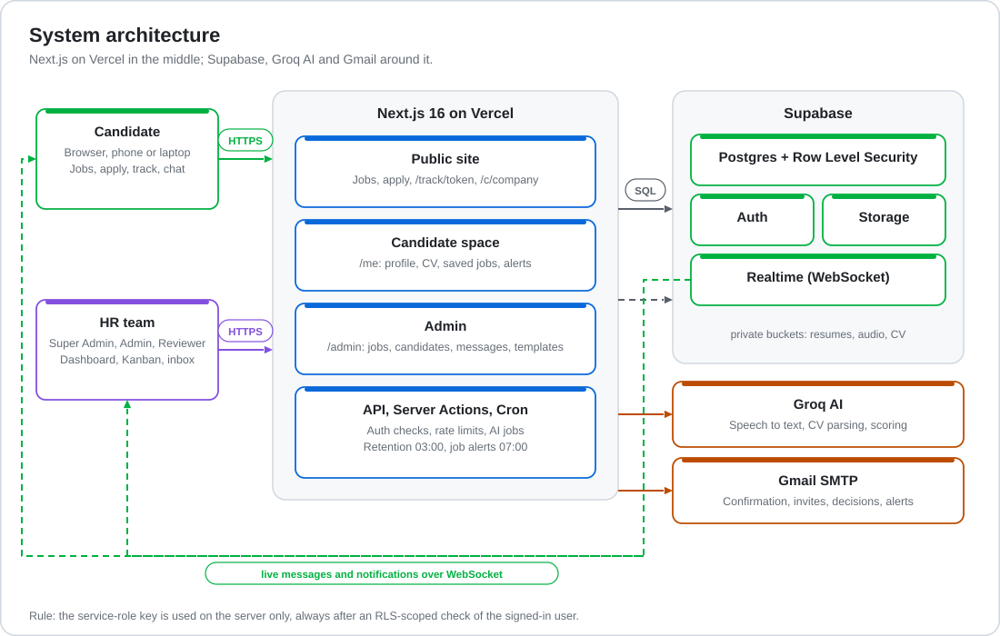

### Candidate journey
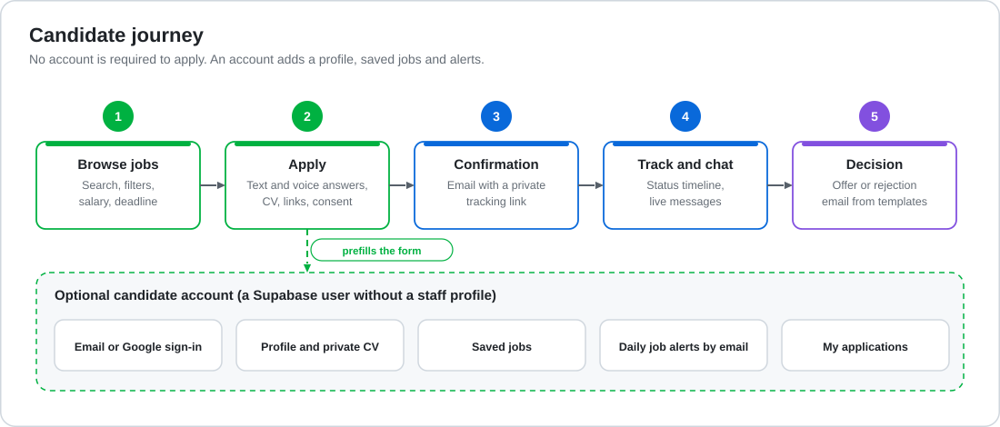

### HR workflow
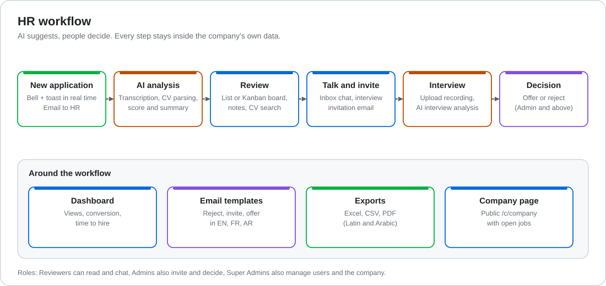

### Real-time chat and read receipts
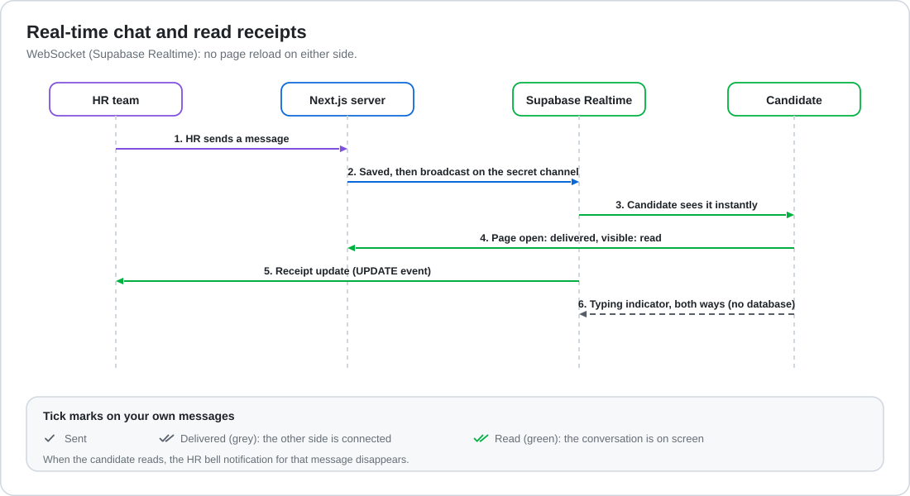

### Security model
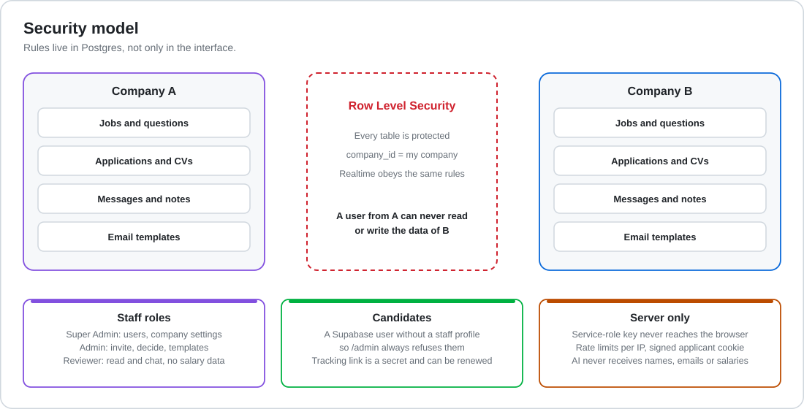

## Screens

> Animated captures of the real application, recorded with sample data (company, candidates and messages are fictional).

### Public jobs page
Search, filters, salary, deadline and saved jobs.

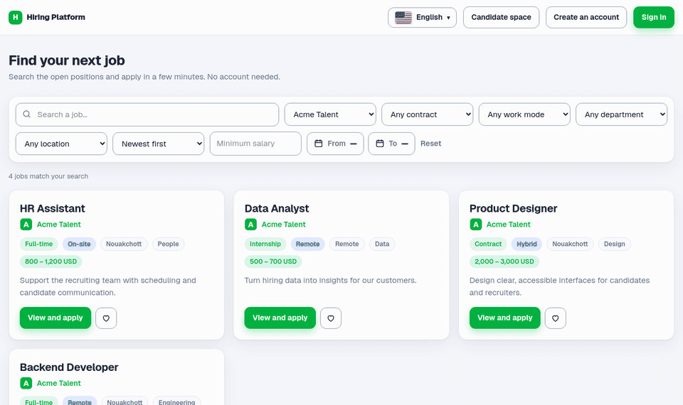

### Application form
Steps, prefilled data and text or voice answers.

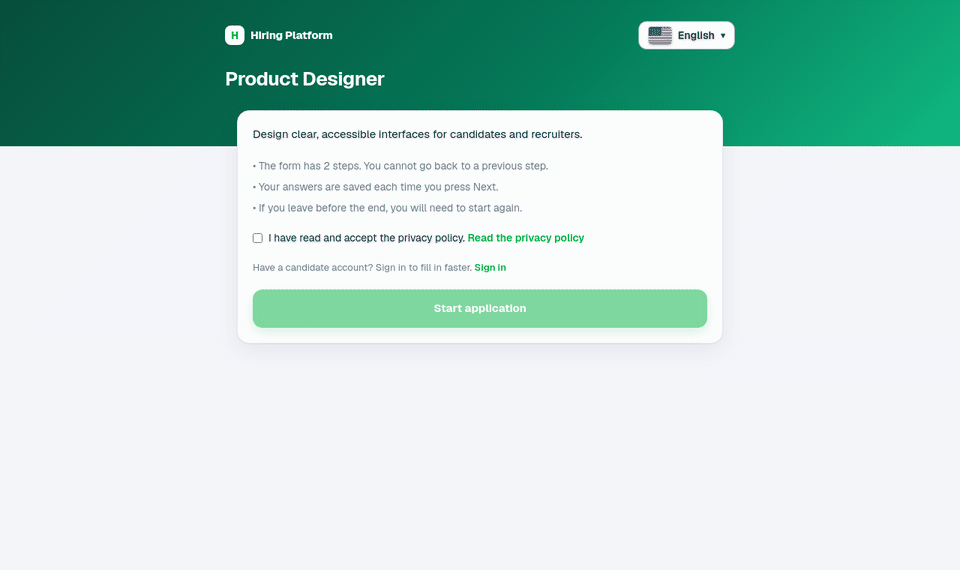

### Application tracking
Private status page with live chat and read receipts.

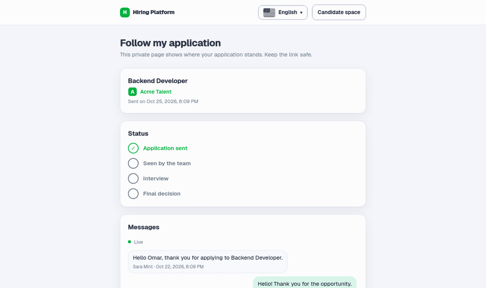

### Candidate space
Profile, private CV and job alerts.

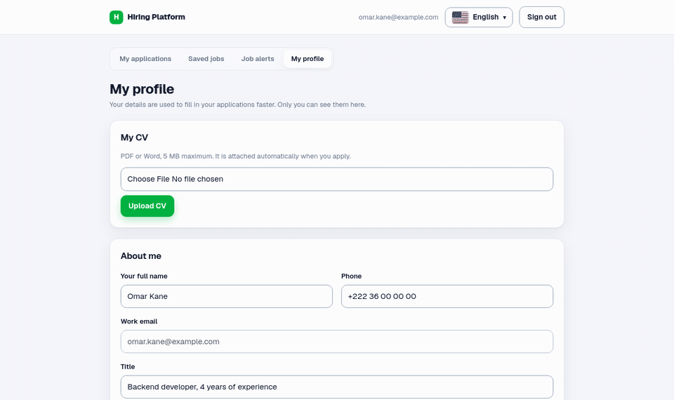

### HR dashboard
Key numbers, daily chart, funnel and jobs table.

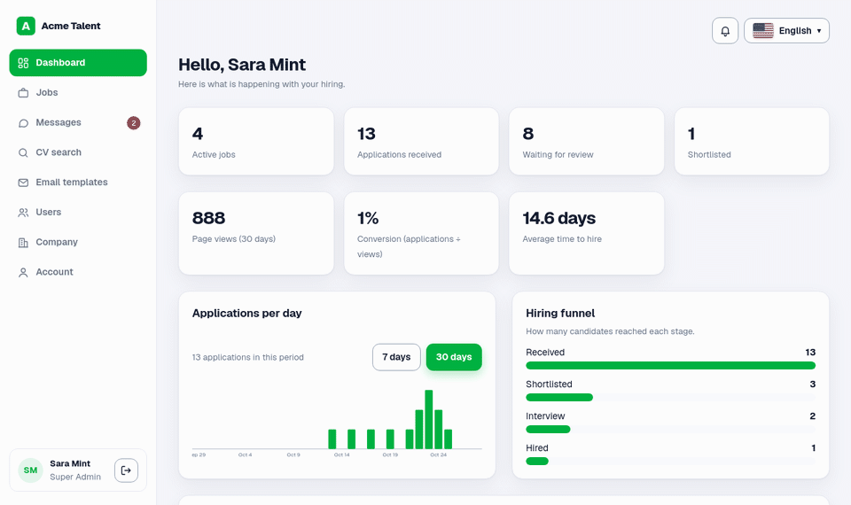

### Kanban board
Drag candidates between stages.

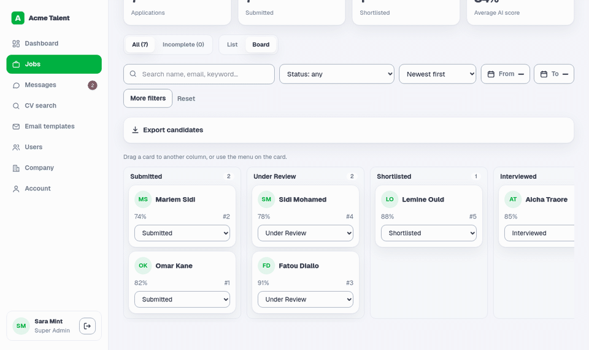

### Candidate details
AI suggestion, answers, notes, decision and messages.

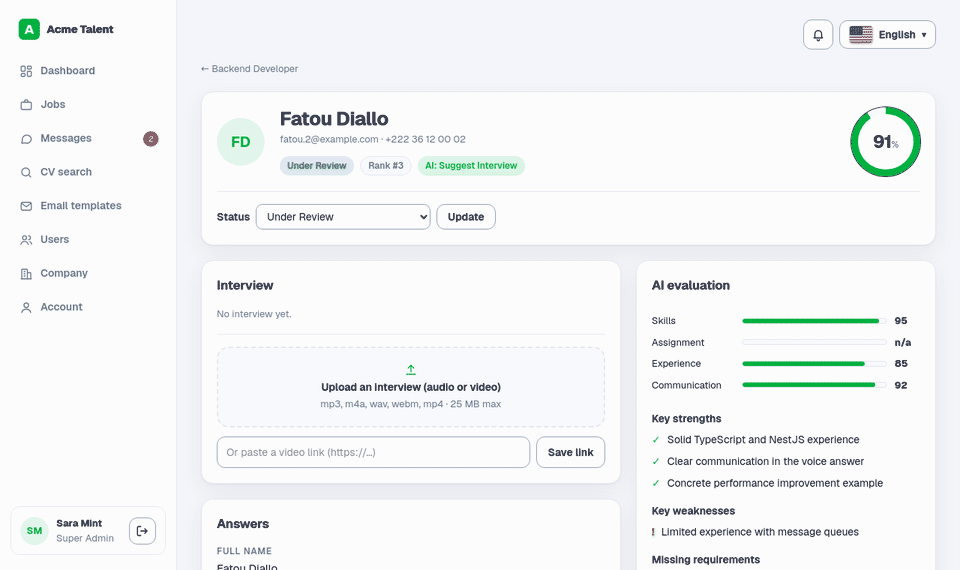

### AI video interview
The AI writes the questions, the candidate answers on camera from a private link, and the AI evaluates the answers. The fake camera in this recording shows a placeholder person.

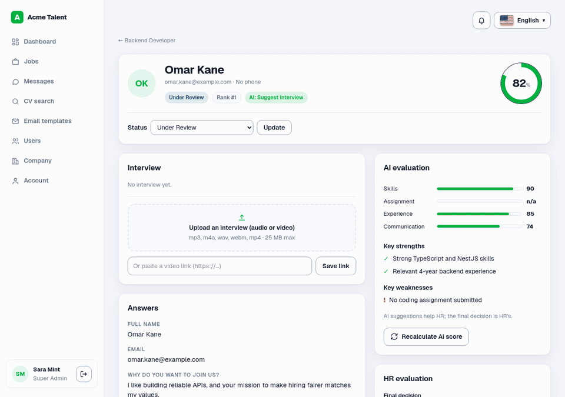

### Messages inbox
Live conversations with unread badges and ticks.

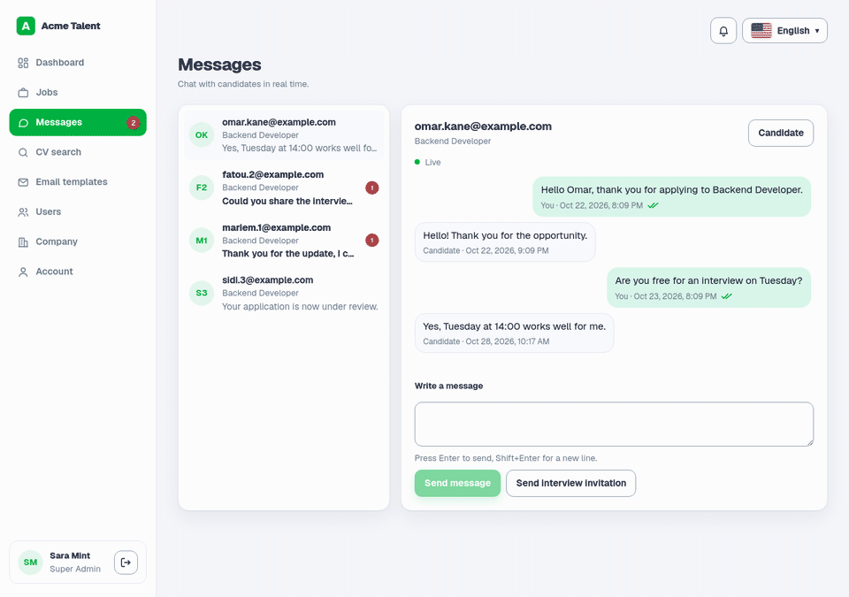

## Tech stack

| Area | Technology |
|---|---|
| Framework | Next.js 16 (App Router, Turbopack, Cache Components), React 19, TypeScript |
| Styling | Tailwind CSS 4 |
| Database / Auth / Storage / Realtime | Supabase (Postgres, RLS, private buckets, Realtime) |
| AI | Groq (speech-to-text, resume parsing, evaluation) |
| Email | Gmail SMTP through Nodemailer |
| Hosting (planned) | Vercel (with Cron Jobs) |

## Getting started

### Prerequisites
- Node.js 22+
- A Supabase project
- A Groq API key and a Gmail account with an app password (for email)

### Installation
```bash
git clone <your-repo-url>
cd hiring-platform
npm install
```

### Database
1. In the Supabase SQL Editor, run every file in `supabase/migrations/` **in order** (`001` → `018`).
2. In **Authentication → Sign In / Providers**, keep sign-ups enabled and turn **Confirm email** on (candidate sign-up requires it).
3. Optional, for Google sign-in: enable the Google provider and add `http://localhost:3000/**` to **Redirect URLs**.
4. Create the first company through `/register`. Then make your account the platform owner:
   ```sql
   update profiles set is_platform_admin = true
   where id = (select id from auth.users where email = 'YOUR_EMAIL');
   ```

### Environment variables
Create `.env.local` (never commit it):

| Variable | Required | Purpose |
|---|---|---|
| `NEXT_PUBLIC_SUPABASE_URL` | yes | Supabase project URL |
| `NEXT_PUBLIC_SUPABASE_PUBLISHABLE_KEY` | yes | Supabase publishable (public) key |
| `SUPABASE_SERVICE_ROLE_KEY` | yes | Supabase secret key. **Server only.** Also signs applicant session cookies |
| `GROQ_API_KEY` | yes | AI features |
| `GMAIL_USER`, `GMAIL_APP_PASSWORD` | yes | Transactional email |
| `CRON_SECRET` | yes | Bearer secret that protects `/api/cron/*` |
| `NEXT_PUBLIC_SITE_URL` | production | Public URL used in email links |
| `EMAIL_FROM` | no | Sender, e.g. `Company <hr@example.com>` |
| `NEXT_PUBLIC_COMPANY_NAME` | no | Platform name on public pages (default: Hiring Platform) |
| `TRANSCRIBE_MODEL`, `CLEAN_MODEL`, `PARSE_MODEL` | no | AI model overrides |

### Run
```bash
npm run dev      # http://localhost:3000
npm run build    # production build
npm run start    # run the production build
npm run lint
```

Check translations (English is the reference; TypeScript refuses missing keys):
```bash
npx tsx --tsconfig tsconfig.json scripts/check-i18n.ts
```

## Project structure
```
src/
  app/            Routes (public jobs, apply, track, candidate space /me, admin, API, cron)
  components/     Shared UI (chat, header, inputs)
  i18n/           en / fr / ar messages and helpers
  lib/            Auth, AI, email, realtime, rate limit, export, Supabase clients
supabase/
  migrations/     SQL migrations 001 → 018 (schema, RLS, storage, realtime)
scripts/          Tooling (i18n check)
docs/images/      SVG diagrams and animated GIF screens used in this README
```

## Security notes
- Staff roles and company isolation are enforced by Postgres RLS, not only by the UI.
- A candidate account is a Supabase user **without** a `profiles` row, so it can never open `/admin`.
- Applicants have no password: a signed session cookie protects an in-progress application.
- The tracking link (`/track/<token>`) is a secret. HR can renew it from the candidate page.
- Names, emails, phones and salaries are not sent to the AI.
- The service-role key is used on the server only, always after an RLS-scoped user check.
- Reviewers never see salary data (database rules).

## Deployment checklist (Vercel)
- Set all environment variables, including `CRON_SECRET` and `NEXT_PUBLIC_SITE_URL`
- Update the Supabase **Site URL** and **Redirect URLs**, and the Google OAuth redirect, for the production domain
- AI routes use `maxDuration = 300`; check that your Vercel plan allows it
- Cron jobs are declared in `vercel.json` (retention at 03:00, job alerts at 07:00)
- Remove or deactivate test jobs and rotate any key that was shared during development
- Replace Gmail SMTP with a transactional email provider (Gmail allows roughly 500 emails per day)

## Known limitations
- Job content and AI-generated text are not translated; they stay in the language they were written in
- Interview files: 25 MB max (Whisper limit); links are stored but not analysed
- Candidate lists and search use the latest 1000 applications per job
- AI evaluation texts (strengths, weaknesses, interview questions) are in English

## License
Proprietary. All rights reserved.
